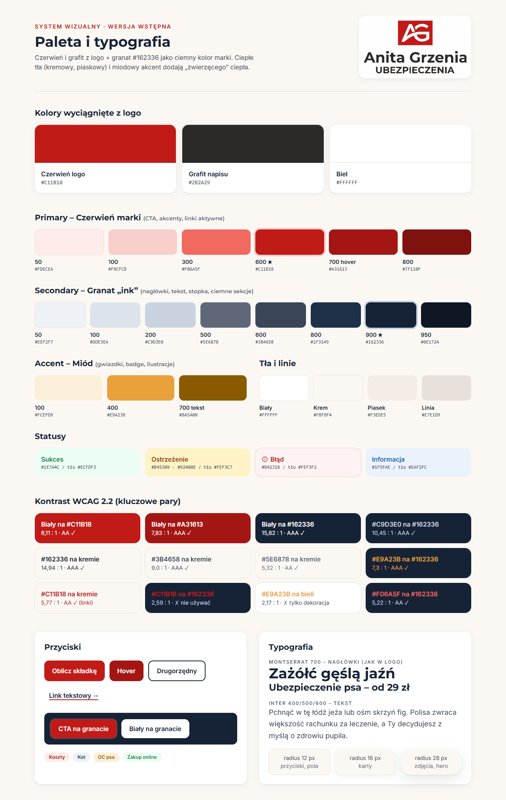
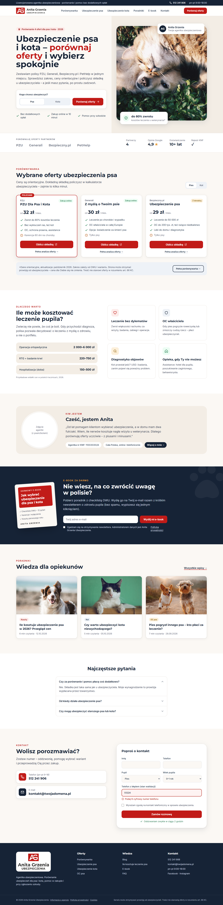

# Kolorystyka i wstępny projekt – Anita Grzenia Ubezpieczenia (ubezpieczenia psa i kota)

Wersja wstępna, 19.10.2026. Makiety HTML leżą w repo `pet-insurance-webside` w folderze `design/` (niezacommitowane): `design/index.html` (strona główna), `design/paleta.html` (paleta i komponenty), `design/tailwind-config.js` (wspólne tokeny). Otwierasz je wprost w przeglądarce (Tailwind i fonty ładują się z CDN).

Zrzuty ekranu:

- Paleta: [`media/paleta.png`](media/paleta.png)
- Strona główna, desktop 1440 px: [`media/mockup-desktop.png`](media/mockup-desktop.png)
- Strona główna, mobile 390 px: [`media/mockup-mobile.png`](media/mockup-mobile.png)

---

## 1. Logo – co z niego wynika

Plik `resources/logo.jpg` (1200×1200 px, JPG na białym tle). Kolory zmierzone jako średnia pikseli:

| Element | Kolor | Uwagi |
|---|---|---|
| Kwadrat ze znakiem „AG” | **#C11B18** | mocna, lekko ciepła czerwień (karmin) |
| Napis „Anita Grzenia / UBEZPIECZENIA” | **#2B2A29** | ciepły grafit, prawie neutralny |
| Tło, litery „AG” | #FFFFFF | |

Krój napisu w logo to geometryczny bezszeryfowy, bardzo zbliżony do **Montserrat** (SemiBold/Bold). Dlatego Montserrat idzie na nagłówki – strona i logo wyglądają spójnie.

Braki techniczne: logo jest tylko w JPG z białym tłem, w wersji pionowej. Do serwisu potrzebne są: **SVG**, wersja **pozioma** (znak + napis obok – do nagłówka), wersja **biała/negatyw** (do granatowej stopki) i favicon (sam znak AG). W makiecie wycinam znak AG z JPG przez CSS i dopisuję napis fontem Montserrat; w stopce logo stoi na białej plakietce.

---

## 2. Werdykt w sprawie #162336

**Tak – używamy #162336 jako ciemnego koloru marki** (nagłówki, stopka, ciemne sekcje, pasek górny, przyciski drugorzędne).

Dlaczego pasuje:

- Granat + czerwień to klasyczna para w ubezpieczeniach i finansach: granat kojarzy się ze stabilnością i zaufaniem, czerwień z logo daje energię i wyróżnia CTA. Ciepła czerwień i chłodny granat ładnie się równoważą.
- Grafit z logo (#2B2A29) jest neutralny, więc granat z nim nie gryzie. To dalej „ciemny kolor”, tylko z charakterem – czysty grafit na całej stronie byłby smutny.
- Kontrast z bielą **15,8 : 1** i z kremowym tłem 14,9 : 1 (AAA). Świetny na tekst i duże ciemne płaszczyzny.

Zasady, żeby działał dobrze:

1. **Nie przekolorowujemy logo** na granat. Napis w logo zostaje grafitowy (#2B2A29).
2. **Logo nie stawiamy bezpośrednio na granacie** – grafit i granat mają kontrast tylko 1,1 : 1, napis zniknie. Na ciemnym tle: biała wersja logo albo logo na białej plakietce.
3. **Czerwony tekst na granacie odpada** (#C11B18 na #162336 = 2,59 : 1). Na granacie tekst jest biały, #C9D3E0 albo jasna czerwień #F06A5F (5,2 : 1). Czerwony przycisk z białym napisem na granacie jest OK (liczy się kontrast napisu), warto dodać mu delikatny jasny ring.
4. Granat jest chłodny, więc tła robimy **ciepłe** (krem, piasek) i dodajemy miodowy akcent. Inaczej strona wygląda korporacyjnie jak bank, a ma być ciepła i „dla pupili”.
5. Długi tekst (akapity bloga) piszemy odcieniem **#3B4658**, nie samym #162336. Czyta się lżej, a nagłówki dalej się wyróżniają.

---

## 3. Paleta

Proporcje (60/30/10): ~60% jasne tła (krem/biel/piasek), ~30% granat (tekst, stopka, sekcja e-book), ~10% czerwień (CTA, wyróżnienia). Miód to „przyprawa” – gwiazdki, badge, drobne ilustracje.

### Primary – czerwień marki (z logo)

| Token | Hex | Rola |
|---|---|---|
| `brand-50` | #FDECEA | tło badge, wyróżnione tło karty, hover jasny |
| `brand-100` | #F8CFCB | focus ring przycisku CTA, obramowania |
| `brand-300` | #F06A5F | czerwony tekst/ikona **na granacie** |
| **`brand-600`** | **#C11B18** | **główne CTA** („Oblicz składkę”, „Porównaj oferty”), słowo-akcent w H1, aktywny link, ramka karty „Polecane” |
| `brand-700` | #A31613 | hover/pressed CTA, czerwony tekst na `brand-50` |
| `brand-800` | #7F110F | stany aktywne, ciemne detale |

### Secondary – granat „ink”

| Token | Hex | Rola |
|---|---|---|
| `ink-50` | #EEF2F7 | tło przełączników (pies/kot), boksów informacyjnych |
| `ink-100` | #DDE3EA | obramowania pól formularzy |
| `ink-200` | #C9D3E0 | tekst na granacie (stopka, sekcja e-book) |
| `ink-500` | #5E6878 | tekst pomocniczy, metadane, podpisy |
| `ink-600` | #3B4658 | **tekst akapitów** |
| `ink-800` | #1F3149 | hover ciemnych przycisków, linki menu |
| **`ink-900`** | **#162336** | **nagłówki, stopka, sekcje ciemne, pasek górny, przycisk drugorzędny (obrys)** |
| `ink-950` | #0E1724 | dół stopki, najgłębszy cień |

### Accent – miód (ciepło, „zwierzęcy” klimat)

| Token | Hex | Rola |
|---|---|---|
| `honey-100` | #FCEFD9 | tło badge (np. „OC psa”, „Z doradcą”) |
| `honey-400` | #E9A23B | gwiazdki ocen, ilustracje, nadtytuł na granacie. **Nie jako tekst na białym** (2,2 : 1) |
| `honey-700` | #8A5A00 | tekst na `honey-100` |

CTA = czerwień marki (`brand-600`). Miodu nie używamy na przyciski – konkurowałby z czerwienią.

### Tła i neutralne

| Token | Hex | Rola |
|---|---|---|
| `white` | #FFFFFF | karty, formularze, nagłówek, sekcje naprzemienne |
| `cream` | #FBF8F4 | **domyślne tło strony** (ciepła biel) |
| `sand` | #F3EDE5 | sekcje wyróżnione (hero – prawa połowa, „O mnie”, tabela kosztów) |
| `line` | #E7E1D9 | linie, obramowania kart |
| `charcoal` | #2B2A29 | tylko logo / napis logotypu |

### Statusy

| Status | Tekst/ikona | Tło | Uwagi |
|---|---|---|---|
| Sukces | #1E7A4C | #ECFDF3 | „w zakresie” ✓ w kartach, „Zakup online”, potwierdzenia |
| Ostrzeżenie | #B45309 (ikona), #92400E (tekst) | #FEF3C7 | karencja, wyłączenia, „na co uważać” |
| Błąd | #B42318 | #FEF3F2 | walidacja formularzy |
| Informacja | #1F5FAE | #EAF2FC | notki „Aktualizacja danych”, podpowiedzi |

Błąd jest blisko czerwieni marki, więc **zawsze** idzie z ikoną (!) i treścią komunikatu, a pole dostaje czerwoną ramkę 2 px i jasnoróżowe tło. Nie opieramy przekazu wyłącznie na kolorze.

### Kontrast WCAG 2.2 (policzony)

| Para (tekst na tle) | Kontrast | Wynik |
|---|---|---|
| biały na #C11B18 (przycisk CTA) | 6,11 : 1 | AA ✓ (każdy rozmiar) |
| biały na #A31613 (hover CTA) | 7,83 : 1 | AAA ✓ |
| biały na #162336 | 15,82 : 1 | AAA ✓ |
| #C9D3E0 na #162336 (tekst stopki) | 10,45 : 1 | AAA ✓ |
| #162336 na #FBF8F4 (nagłówki) | 14,94 : 1 | AAA ✓ |
| #3B4658 na #FBF8F4 (akapity) | 9,0 : 1 | AAA ✓ |
| #5E6878 na #FBF8F4 / bieli (metadane) | 5,32 / 5,63 : 1 | AA ✓ |
| #C11B18 na #FBF8F4 (link, akcent w H1) | 5,77 : 1 | AA ✓ |
| #A31613 na #FDECEA (badge) | 6,85 : 1 | AA ✓ |
| #E9A23B na #162336 | 7,3 : 1 | AAA ✓ |
| #F06A5F na #162336 | 5,22 : 1 | AA ✓ |
| #1E7A4C na bieli / #ECFDF3 | 5,33 / 5,05 : 1 | AA ✓ |
| #92400E na #FEF3C7 | 6,37 : 1 | AA ✓ |
| #B42318 na bieli | 6,57 : 1 | AA ✓ |
| #8A5A00 na bieli | 5,93 : 1 | AA ✓ |
| #C11B18 na #162336 | 2,59 : 1 | ✗ nie używać |
| #E9A23B na bieli | 2,17 : 1 | ✗ tylko dekoracja |

---

## 4. Typografia, kształty, ikony, zdjęcia, ton

**Fonty (Google Fonts, pełne polskie znaki, `subset=latin-ext`):**

- Nagłówki: **Montserrat** 600/700 (800 tylko na wyjątkowo duże liczby). Spójny z logo.
- Tekst: **Inter** 400/500/600 – bardzo czytelny w akapitach, tabelach i cenach (cyfry tabelaryczne `tabular-nums` w porównywarce).
- Alternatywa, jeśli Inter wyda się zbyt „techniczny”: **Nunito Sans** (cieplejszy, bardziej okrągły).
- W Next.js ładujemy przez `next/font` (self-hosting, bez zapytań do Google – lepsze RODO i Core Web Vitals).

Skala: H1 40/48/56 px (mobile/tablet/desktop), H2 30–36 px, H3 18–20 px, akapit 16–18 px z interlinią 1,6–1,7, metadane 14 px. Maks. szerokość akapitu ~68 znaków (`max-w-prose`).

**Zaokrąglenia:** przyciski i pola 12 px, karty 16 px, duże zdjęcia/hero/sekcje-ramki 28 px, badge – pełne (pill). Miękkie, przyjazne, ale nie „dziecinne”.

**Cienie:** delikatne, w kolorze granatu, nie czarne: `card` = `0 1px 2px rgba(22,35,54,.06), 0 4px 16px rgba(22,35,54,.06)`; `lift` (hover, karta polecana, pływające boksy w hero) = `0 2px 4px …/.06, 0 12px 32px …/.10`. Głównie obramowanie 1 px `line` + lekki cień.

**Odstępy:** siatka 4/8 px. Sekcje 64 px (mobile) / 96 px (desktop) w pionie, kontener 1280 px z paddingiem 16/24 px, odstępy między kartami 24 px. Dużo powietrza = spokój i zaufanie.

**Ikony:** liniowe, obrys 2 px, zaokrąglone końcówki – [Lucide](https://lucide.dev) (zgodne z makietą). Ikona w kafelku 48 px z jasnym tłem (brand-50 / ink-50 / honey-100 / success-50). Motyw łapki jako dyskretny znak graficzny (badge w hero, duży półprzezroczysty element w sekcji e-book). Bez emoji w interfejsie.

**Zdjęcia:** prawdziwe, ciepłe, naturalne światło, pupile w domu/na trawie, kontakt wzrokowy zwierzęcia, ludzie z pupilami (ręce, przytulanie). Bez zdjęć „gabinetowych” ze strzykawką i bez smutnych/chorych zwierząt. Bez widocznych logotypów marek na zdjęciach. Kluczowe: **prawdziwe zdjęcie agentki** (najlepiej z własnym psem/kotem) – największy wyróżnik względem anonimowego konkurenta. Format WebP/AVIF, `aspect-ratio` stałe (4:3 hero mobile, 16:10 miniatury bloga). W makiecie: zdjęcia z Unsplash jako placeholdery.

**Ton komunikacji:** „rzetelna sąsiadka-ekspertka”. Na „Ty”, ciepło, konkretnie, bez straszenia. Uczciwie o wyłączeniach i karencjach (w kartach jest punkt „na co uważać”). Liczby zawsze z datą aktualizacji i dopiskiem „orientacyjnie”. Przykładowe frazy: „Porównaj oferty i wybierz spokojnie”, „Wolisz porozmawiać? Oddzwonię”, „Decydujesz z myślą o zdrowiu pupila, nie o portfelu”.

---

## 5. Strona główna – układ (makieta `design/index.html`)

Kolejność sekcji:

1. **Pasek górny** (granat, tylko desktop): „Licencjonowana agentka…”, telefon, godziny.
2. **Nagłówek** (biały, sticky): znak AG + napis, menu (Porównywarka, Ubezpieczenie psa, Ubezpieczenie kota, Poradniki, E-book, Kontakt), czerwone CTA „Porównaj oferty”. Mobile: hamburger.
3. **Hero** (krem + piaskowa prawa połowa): badge z łapką „Porównanie 4 ofert… 2026”, H1 z frazą SEO „Ubezpieczenie psa i kota – porównaj oferty…”, lead, **boks wyboru Pies/Kot + CTA** (wejście do porównywarki z parametrem), 3 punkty zaufania z ✓. Po prawej zdjęcie pies+kot, pływające karty: „Anita Grzenia – Twoja agentka” i „do 80% zwrotu”.
4. **Sygnały zaufania** (biały pas): partnerzy PZU / Generali / Bezpieczny.pl / PetHelp (docelowo logotypy w szarości, jeśli umowy pozwalają) + liczby: partnerzy, ocena Google, lata doświadczenia, wpis w rejestrze KNF (wartości do potwierdzenia u klientki).
5. **Zajawka porównywarki**: przełącznik Pies/Kot, 3 karty ofert (nazwa, ubezpieczyciel, badge „Zakup online”/„Z doradcą”, „od X zł/mies.”, 3 plusy ✓ + 1 „na co uważać” ⚠, CTA „Oblicz składkę” z ikoną linku zewnętrznego, „Pełna analiza oferty →”). Karta polecana ma czerwoną ramkę i etykietę. Pod spodem nota o prowizji/art. 66 KC i przycisk „Pełna porównywarka →”.
6. **Dlaczego warto** (biały): tabela „Ile może kosztować leczenie?” (widełki cen) + 4 kafle korzyści (leczenie, OC, diagnostyka, assistance).
7. **Kim jestem** (piaskowa ramka): zdjęcie agentki, krótki cytat, numer KNF, zasięg, „Więcej o mnie →”. Ważne dla E-E-A-T i dla „wizytówki”.
8. **E-book** (granat): okładka e-booka (czerwony blok + checklisty), nagłówek, pole e-mail + przycisk, zgoda RODO.
9. **Blog / poradniki**: 3 karty (zdjęcie, kategoria-badge, tytuł, czas czytania, data).
10. **FAQ** (biały, accordion, `FAQPage` schema).
11. **Kontakt**: telefon i e-mail jako duże klikalne karty + formularz „Poproś o kontakt” (imię, telefon, pies/kot, wiek do 10+, zgoda). W makiecie pokazany stan błędu walidacji i komunikat sukcesu.
12. **Stopka** (granat): logo na białej plakietce, kolumny Oferty / Wiedza / Kontakt, linki prawne (Informacja o agencie, Polityka prywatności, Cookies), nota o prowizji.

**Mobile** (390 px):

- Wszystko w jednej kolumnie; w hero najpierw tekst i boks Pies/Kot, zdjęcie pod spodem (szybki LCP tekstu, CTA nad zgięciem).
- Pasek górny ukryty, telefon przeniesiony do **przyklejonego dolnego paska**: ikona telefonu + „Porównaj oferty”.
- Karty ofert jedna pod drugą, CTA na całą szerokość, cele dotykowe min. 44–48 px.
- Partnerzy zawijają się w 2 wiersze, statystyki w siatce 2×2.
- Stopka ma dodatkowy dolny padding, żeby nie chował jej pasek CTA.

---

## 6. Porównywarka `/porownywarka` – projekt wstępny

**Desktop:**

- Nagłówek strony: breadcrumbs, H1 „Porównywarka ubezpieczeń dla psa i kota 2026”, 1 zdanie leadu, notka „Aktualizacja danych: …” (info-niebieska).
- Duży przełącznik **Pies / Kot** (segmentowy, jak w hero) – zmienia `?gatunek=`.
- Układ 2-kolumnowy: **lewy panel filtrów** (sticky, 280 px): typ (ubezpieczenie / pakiet weterynaryjny / pakiet + ubezpieczenie), wiek pupila (0–1, 1–3, 4–7, 8–10, 10+), budżet miesięczny (suwak), checkboxy: OC, profilaktyka, zakup online, dowolna lecznica. Przycisk „Wyczyść filtry”.
- Prawa część: pasek „Znaleziono 4 oferty” + sortowanie (polecane / cena / suma leczenia) + przełącznik widoku **Karty / Tabela**.
- **Widok kart** (jak na stronie głównej, ale szerszy: dodatkowo suma leczenia, % zwrotu, karencja, wiek przystąpienia). Checkbox „Porównaj” na karcie → dolna szuflada „Porównaj zaznaczone (2/3)”.
- **Widok tabeli**: oferty w kolumnach, parametry w wierszach (leczenie po wypadku/chorobie, diagnostyka, operacje, profilaktyka, OC, karencja, wiek, chip, maks. suma, % zwrotu, cena od). Pierwsza kolumna i wiersz z nazwami przyklejone. ✓ zielone, ✗ szare, „opcja” miodowy badge. W ostatnim wierszu CTA „Oblicz składkę” + linki „Analiza | OWU”.
- Pod listą: „Nie wiesz, co wybrać? Zadzwoń / Zamów rozmowę” (granatowy baner), FAQ porównywarki, nota o prowizji.
- Linki CTA idą przez `/wycena/<partner>?src=porownywarka-karta` (śledzenie, `rel="sponsored nofollow"`, nowa karta).

**Mobile:**

- Filtry w **dolnym arkuszu** (bottom sheet) po kliknięciu „Filtry (2)”; sortowanie jako select.
- Tylko widok kart; porównanie 2 ofert w tabeli z poziomym przewijaniem i przyklejoną kolumną parametrów.
- Lista musi się renderować **bez JS** (SSR/SSG) – filtry jako ulepszenie (lepsze SEO niż u konkurenta).

---

## 7. Wpis blogowy `/blog/<slug>` – projekt wstępny

**Desktop:**

- Breadcrumbs → kategoria (badge) → H1 (Montserrat 40–48 px) → lead → **pasek autora**: zdjęcie Anity, „Anita Grzenia, agentka ubezpieczeniowa”, data publikacji i aktualizacji, czas czytania.
- Zdjęcie główne 16:9, radius 28 px.
- Układ: treść 680–720 px + **prawa kolumna sticky** (spis treści z podświetlaniem bieżącej sekcji, mini-CTA „Porównaj oferty dla psa”, ewentualnie okładka e-booka).
- Elementy treści: boks „W skrócie” (TL;DR, tło `ink-50`), tabele kosztów (zebra `cream`), cytaty/porady w ramce z lewą krawędzią czerwoną, ostrzeżenia w `warning-50`, **wstawka produktowa w środku tekstu** (mała karta oferty z CTA), FAQ na końcu (schema).
- Po treści: boks autora (bio, uprawnienia, link „O mnie”), e-book CTA (granat), 3 powiązane wpisy, link do hubu (np. „Ubezpieczenie psa”).
- Schema `BlogPosting` + `Person` (autor) + `BreadcrumbList`.

**Mobile:**

- Spis treści jako rozwijany „Spis treści ▾” pod leadem; prawa kolumna znika, mini-CTA wstawione po 2. sekcji i na końcu.
- Tabele przewijane w poziomie z cieniem krawędzi; tekst 17–18 px, interlinia 1,7.
- Dolny pasek CTA jak na stronie głównej (telefon + „Porównaj oferty”).

---

## 8. Tokeny do wdrożenia

Gotowa konfiguracja w `design/tailwind-config.js` (kolory `brand`, `ink`, `honey`, `cream`, `sand`, `line`, `charcoal`, statusy, fonty `heading`/`sans`, `rounded-card`/`rounded-btn`, cienie `shadow-card`/`shadow-lift`). Przy budowie aplikacji przenosimy to do `tailwind.config` lub do CSS variables (`@theme` w Tailwind v4).

## 9. Do ustalenia z klientką

1. Logo w SVG + wersja pozioma i biała (lub zgoda na przygotowanie ich przez nas na bazie JPG).
2. Zdjęcie/sesja agentki (najlepiej z pupilem) i zdjęcia klientów z pupilami (za zgodą).
3. Prawdziwe dane do sygnałów zaufania: numer w rejestrze KNF, lata doświadczenia, ocena Google, liczba klientów.
4. Czy można używać logotypów ubezpieczycieli (umowy agencyjne/partnerskie).
5. Akceptacja kierunku: czerwień + granat + ciepłe tła. Alternatywa do pokazania, jeśli granat się nie spodoba: grafit #2B2A29 z logo jako ciemny kolor (spójniejszy z logo, ale chłodniejszy emocjonalnie i mniej „zaufania” niż granat).
